# Solution Design Hardening

**Build secure software that survives concurrency, failures, threats, and scale.**

     

An open-source, evidence-driven AI coding skill for discovering, preventing, fixing and verifying architectural correctness and security problems in transactional, distributed and highly available applications. Designed for solution architects, backend engineers, platform engineers and coding agents.

[Quick start](#quick-start) · [How it works](#how-it-works) · [Coverage](#coverage) · [Architecture](#architectural-intelligence-v090) · [Security](#comprehensive-security-hardening-v080) · [Benchmarks](#automated-benchmarking-and-agent-integration-v0110) · [Examples](#examples) · [Validation](#validation-and-evaluation) · [Roadmap](#roadmap)

> **v1.0.0-RC1 - Empirical validation.** The local Ollama pilot completed 36 responses, and the default Docker lab passed 12 tests. The provisional rubric found safety flags and false alarms in both model conditions. [Read the pilot results](BENCHMARK-RESULTS.md).

| 235 problems | 24 playbooks | 17 capability profiles | 12 optional product guides |
|:---:|:---:|:---:|:---:|
| 27 candidate scanner rules | 66 agent scenarios | 16 labeled scenarios | 8 activation probes |
| 61 local tests passed | 15 real-service tests defined | 92 advisory security mappings | 8 security capability families |

## Project at a glance

This skill combines universal engineering principles, adaptive technology discovery, security hardening, architecture modeling and verification. It supports assessment, planning, authorized implementation and preventive design/review. Unlike a pattern checklist, it asks what can fail, which business invariant is affected, where evidence exists and how to prove the correction.

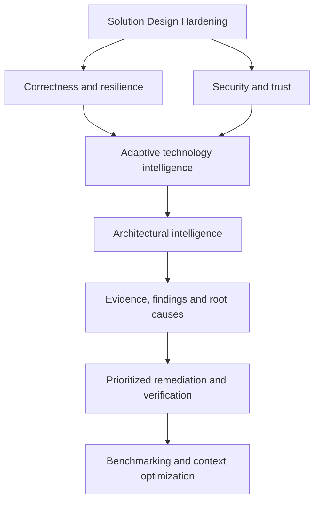

| Dimension | Approach |
|---|---|
| Coverage | Fixed stable problem baseline plus distinct project-specific issues |
| Technology independence | Discover actual capabilities; optional guides never define support |
| Architecture | Trace business operations, data ownership, commit points and trust crossings |
| Security | Assess authorization at effects, input handling, supply chain and agent boundaries |
| Evidence | Separate verified facts, static candidates, unknowns and residual risks |
| Simplicity | Prefer sufficient existing mechanisms, not mandatory pattern adoption |
| Verification | Test invariants under concurrency, failure, recovery and negative controls |
| Evaluation | Matched trials, independent grading, labeled cases and actual usage metrics |


## Why this skill exists

A system may pass ordinary functional tests and still charge customers twice, lose committed events, overwrite newer data, or collapse under retries. Architecture hardening means reasoning about business invariants across real transaction boundaries, concurrent requests, external dependencies, crashes and recovery - not simply checking that a design pattern or library is present.

| Failure scenario | Example mitigation | What must be verified |
|---|---|---|
| Duplicate payment | Durable idempotency and provider reconciliation | Concurrent retries produce one business effect |
| Inconsistent ledger | Atomic balanced postings | Debits and credits balance per currency |
| Database + broker dual write | Transactional outbox | Committed event intent survives interruption |
| Duplicate event processing | Transactional inbox | Replay produces no extra local effect |
| Stale cache refill | Generation-aware cache writes | Older reads cannot defeat invalidation |
| Retry storm | Bounded retries, jitter, deadlines | Downstream load stays within capacity |
| Expired distributed lock | Resource-enforced fencing | Obsolete owners cannot write |
| Mixed-version deployments | Expand-contract migration | Both versions work during rollout |

## Quick start

Install from GitHub with the Skills CLI (requires Node.js/npm):

```sh
npx skills add ameralqarallih-lgtm/solution-design-hardening --skill solution-design-hardening
```

The command assumes this repository and version have been published. To install manually, copy `skills/solution-design-hardening/` into your agent's supported skills directory, such as `.claude/skills/` or `.agents/skills/` where supported. Consult your agent's documentation. The skill uses the [Agent Skills open format](https://agentskills.io/specification); individual agent versions have not yet been compatibility tested.

### Assess an existing codebase

```text
Use solution-design-hardening to assess the entire codebase against the
problem catalog. Provide an evidence-based assessment and prioritized
remediation plan. Do not modify source code.
```

### Implement approved fixes

```text
Use solution-design-hardening to implement the approved remediation tasks.
Follow dependencies, preserve business behavior, and verify failure cases.
```

### Prevent defects while developing or reviewing

```text
Apply solution-design-hardening to this feature or code review.
Identify applicable invariants and failure boundaries; avoid unnecessary patterns.
```

## How it works

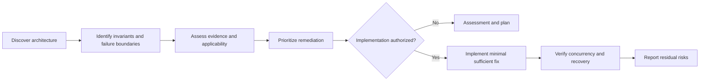

The agent loads only the relevant problem playbooks and technology guides for focused work. Full assessments cover the bundled baseline plus distinct project-specific problems, cross-mapping duplicates. The skill does not require all patterns to be implemented.

## Coverage

235 stable problem IDs, 24 domain playbooks, 17 technology capability profiles, eight cross-cutting security capability families, 12 optional product profiles, 66 scenario-based agent evaluation cases and eight separate activation probes.

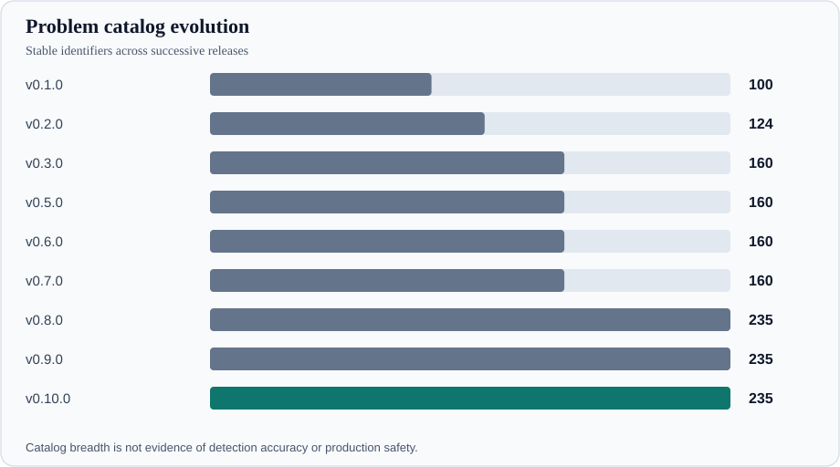

| Domain | Problem IDs | Count |
|---|---|---:|
| Financial and transactional correctness | SDP-001–010, SDP-101–104 | 14 |
| Caching | SDP-011–022 | 12 |
| Databases and consistency | SDP-023–037 | 15 |
| Resilience and distributed coordination | SDP-038–053, SDP-125–130 | 22 |
| Messaging | SDP-054–068 | 15 |
| APIs | SDP-069–080 | 12 |
| Workflows | SDP-081–091 | 11 |
| Object storage | SDP-092–100 | 9 |
| Data migration | SDP-105–111 | 7 |
| Integration and operations | SDP-112–124 | 13 |
| Security | SDP-131–136 | 6 |
| Deployment and resources | SDP-137–145 | 9 |
| Observability and tenancy | SDP-146–150 | 5 |
| Lifecycle | SDP-151–160 | 10 |
| Authentication and identity | SDP-161–170 | 10 |
| Authorization and business-flow security | SDP-171–178 | 8 |
| Injection and untrusted content | SDP-179–192 | 14 |
| Data protection and cryptography | SDP-193–203 | 11 |
| Distributed and infrastructure security | SDP-204–212 | 9 |
| Software supply chain | SDP-213–219 | 7 |
| Security monitoring and operations | SDP-220–225 | 6 |
| AI and agentic application security | SDP-226–235 | 10 |
| **Total** | **SDP-001–235** | **235** |

Browse the [full problem catalog](skills/solution-design-hardening/references/SOLUTION-DESIGN-PROBLEMS.md), [core skill](skills/solution-design-hardening/SKILL.md), and [technology guides](skills/solution-design-hardening/references/technologies/README.md).

### Architectural Intelligence (v0.9.0)

Move from individual pattern detection to evidence-backed understanding of complete business operations. Discover components and declared dependencies, trace actual call paths, map transaction and trust boundaries, identify invariant owners and correlate findings only when their common failure mechanism is supported by evidence.

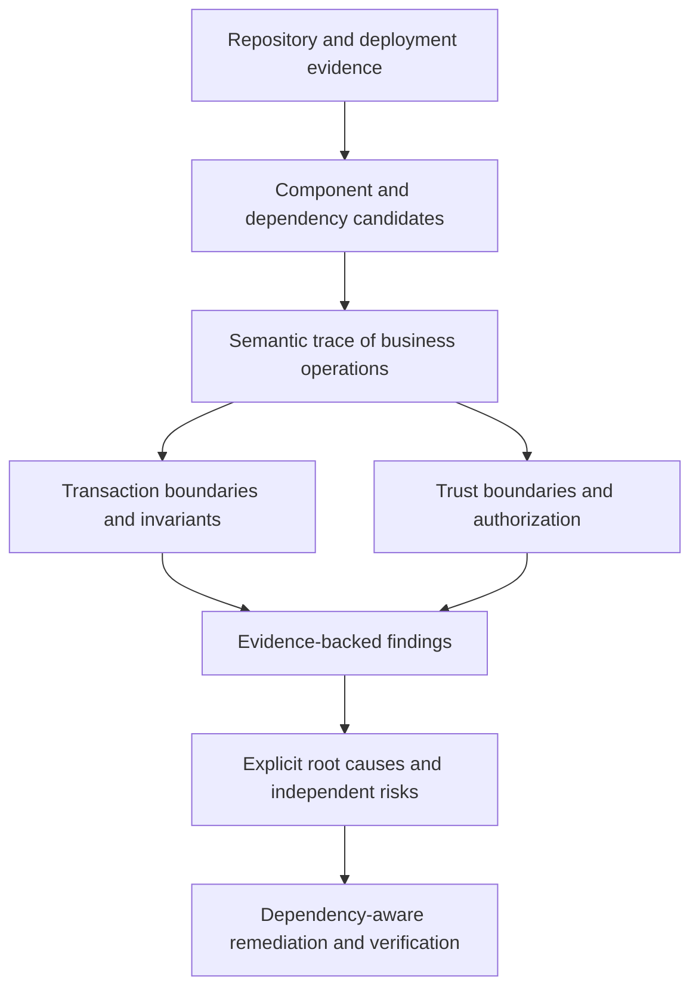

| New capability | What it does | What it does not prove |
|---|---|---|
| Candidate component inventory | Groups project directories and assigns source locations | Actual deployment topology |
| Declared dependencies | Resolves local .NET project and npm file/link references | Runtime call graph or shared transaction |
| Boundary signals | Locates 12 families of likely operations | Call order, authorization or durability |
| Business invariant and trust mapping | Agent traces effects, owners, constraints and permissions | Unobserved requirements or guarantees |
| Root-cause correlation | Links analyst-supported mechanisms to multiple findings | Automatic causal inference from co-location |
| Task dependency validation | Rejects dangling references and cycles, reports task waves | Approval, priority or successful remediation |

Try the optional offline helpers from the repository root:

```sh
python tools/architecture.py /path/to/repository > architecture-candidates.json
python tools/correlate.py examples/architecture-model.json
```

The first command produces candidates, the second validates an illustrative analyst-authored model. See [architecture tooling](tools/ARCHITECTURE.md) and [architectural intelligence guidance](skills/solution-design-hardening/references/ARCHITECTURAL-INTELLIGENCE.md). Full assessments include an architecture model (or an equivalent section in the assessment); focused tasks trace only relevant paths. The skill remains technology-independent even when no automated parser exists.

### Traceability and root-cause correlation

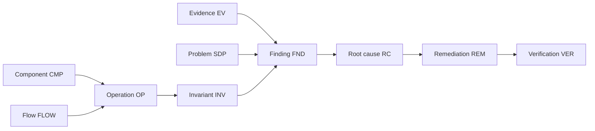

Example: a missing atomic payment claim can produce duplicate charges, concurrent claims and duplicate API submissions. Consolidate only when the evidence proves the same failure mechanism, while retaining individual coverage and acceptance tests. A common invariant alone is insufficient to merge different root causes.

### Comprehensive Security Hardening (v0.8.0)

Security is integrated into the same evidence-driven architecture assessment, not a separate plugin or a product-specific checklist. The release preserves the original 160 entries and adds 75 security scenarios. It covers authentication, resource/function/property authorization, input-to-interpreter boundaries, data and cryptographic protection, workload and network trust, software supply chain, security operations, and AI/agent permissions and data isolation.

| Example security failure | Minimum safeguard | Verification |
|---|---|---|
| Object authorization failure | Enforce ownership or grants at the actual operation | Two principals: denied cross-owner and allowed own-object access |
| Fail-open authorization | Deny protected effects on policy failure | Inject timeout; permitted normal path still works |
| Token validation failure | Verify intended issuer, audience, type, signature and expiry | Invalid token rejected; valid token accepted |
| Unsafe property binding | Allowlist writable fields | Attempt protected-field change; allowed field updates |
| Supply chain integrity | Verify trusted provenance and artifact identity | Reject mismatched artifact and unapproved builder |
| Prompt injection / excessive agency | Enforce authority outside model context | Mock untrusted instruction cannot trigger unauthorized effect |

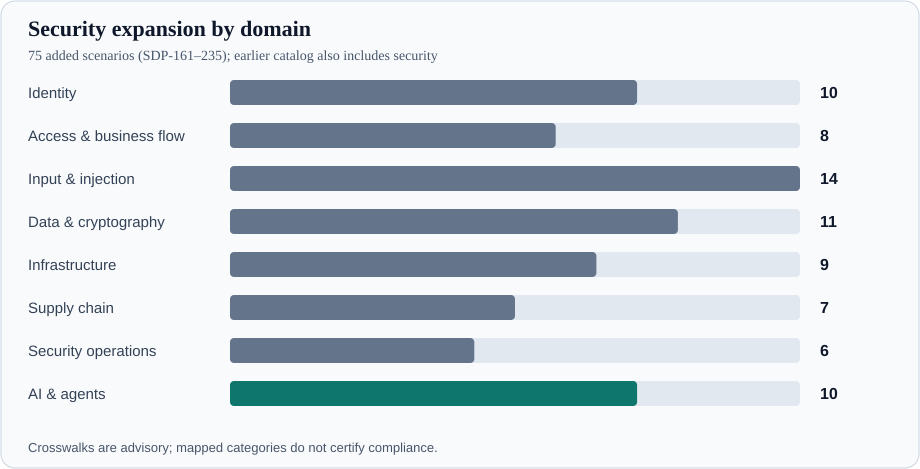

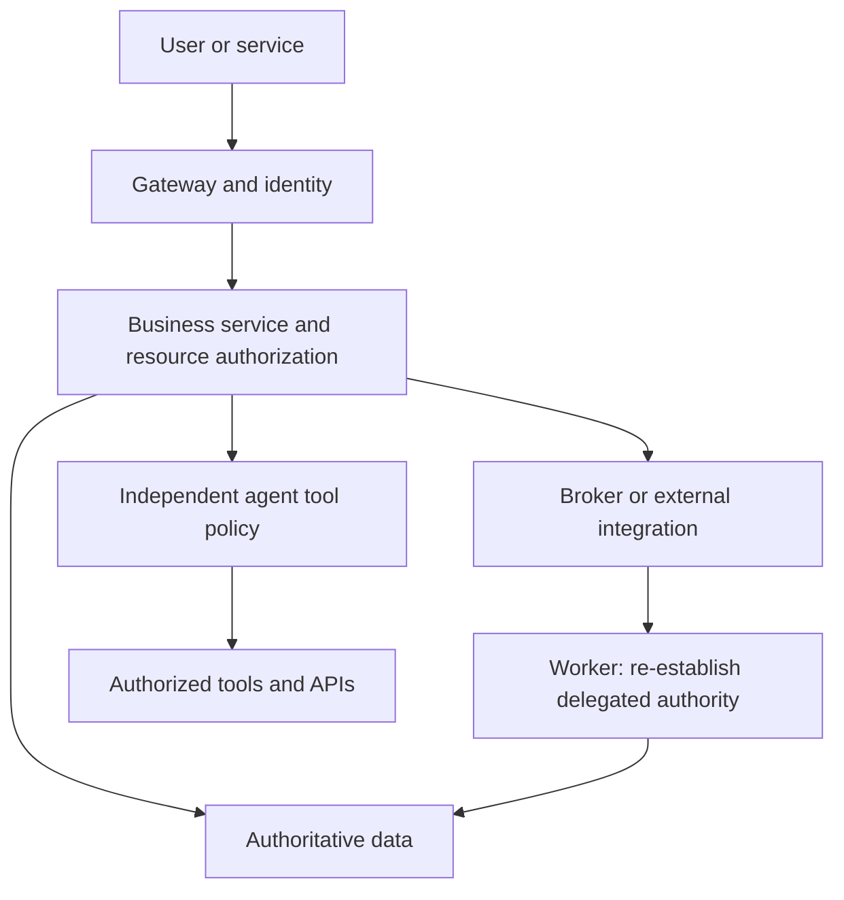

Trust must be verified at the actual protected effect, not merely at the first API request. Use STRIDE to examine spoofing, tampering, repudiation, information disclosure, denial of service and elevation of privilege. For AI applications, retrieved data and model output are untrusted inputs, not authority; enforce permissions, tenant isolation and budgets outside the model.

Start with [security assessment](skills/solution-design-hardening/references/SECURITY-ASSESSMENT.md), [adaptive security capabilities](skills/solution-design-hardening/references/SECURITY-CAPABILITIES.md), [standards traceability](skills/solution-design-hardening/references/SECURITY-STANDARDS.md) and the [threat model template](skills/solution-design-hardening/assets/threat-model.md). Mappings reference OWASP Top 10:2025, API Top 10:2023 and candidate CWE IDs; ASVS 5.0.0, GenAI/Agentic 2026, SSDF, SLSA, CIS and ATT&CK are separate verification inputs. Category-level coverage does not certify compliance.

```text
Use solution-design-hardening to assess security across this codebase.
Map trust boundaries, actors and protected assets; identify applicable
security problems with evidence and propose prioritized remediation.
Do not modify code or probe external/production systems.
```

Local security fixtures use synthetic principals and SQLite or mock policy/tool calls. They reproduce missing object scoping and unsafe property binding, and verify scoped fixes, parameter binding, sequential token redemption, fail-closed policy and external tool authorization. They do not validate a real identity provider, web server, cryptographic protocol or agent model. See [security reporting](SECURITY.md) for responsible disclosure.

### Adaptive Technology Intelligence

**No fixed supported-technology list.** Discover the stack dynamically, identify the capabilities required by the business invariant, verify version and configuration, then select the simplest supported implementation. Unlisted or proprietary technologies follow the same workflow; unverifiable guarantees remain open verification tasks.

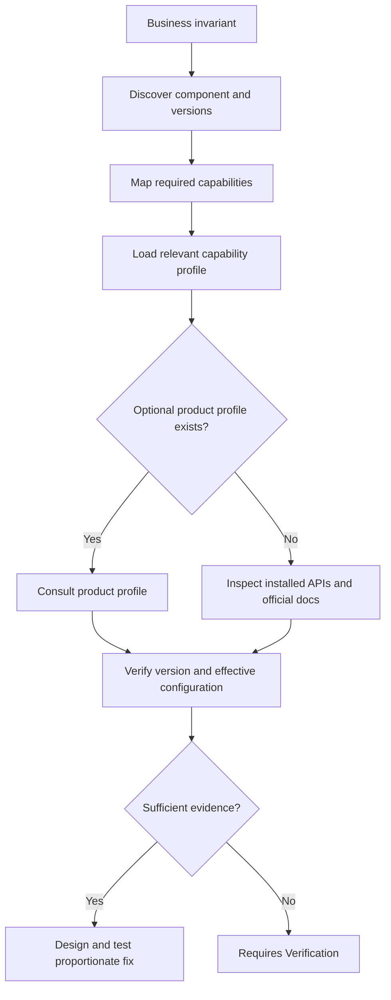

| Layer | Responsibility |
|---|---|
| Universal problems | 235 stable failure scenarios and 24 playbooks |
| Discovery | Component-specific manifest, dependency, configuration and topology evidence |
| Capability mapping | 17 reusable technology-independent domains |
| Product profiles | 12 optional accelerators, not prerequisites |
| Verification | Separate declared, resolved and deployed versions; verify effective guarantees |

The [capability index](skills/solution-design-hardening/references/technology/CAPABILITY-MAPPING.md) includes databases, caching, messaging, streaming, workflows, workers, storage, runtimes, data access, coordination, orchestration, serverless, identity, APIs, search and observability. Existing profiles for .NET, Java, Node.js, Python, SQL Server, PostgreSQL, MongoDB, Redis, RabbitMQ, Kafka, Kubernetes and S3-compatible storage remain available. None is a claim of tested product compatibility.

**Example:** An unfamiliar queue with a `complete()` API is not assumed to behave like RabbitMQ. The agent verifies acknowledgment, durability and replay semantics and tests the failure boundary after the consumer commit. If it cannot establish those guarantees, it records Requires Verification rather than inventing an API or recommending unnecessary migration.

Use the [technology inventory template](skills/solution-design-hardening/assets/technology-inventory.md) for traceable evidence. Optional manifest discovery:

```sh
python tools/discover.py /path/to/repository
```

The helper is offline and read-only. It recognizes selected manifest filenames and limited toolchain version metadata; it does not resolve dependencies, inspect deployed services or prove capabilities. Missing signals do not imply an unsupported stack.

## Automated Benchmarking and Agent Integration (v0.11.0)

The built-in runner uses the same synthetic scenario and model settings in each pair. The skill condition adds a fixed set of reference files. The runner randomizes condition order, starts fresh sessions, and keeps condition metadata out of the review packet.

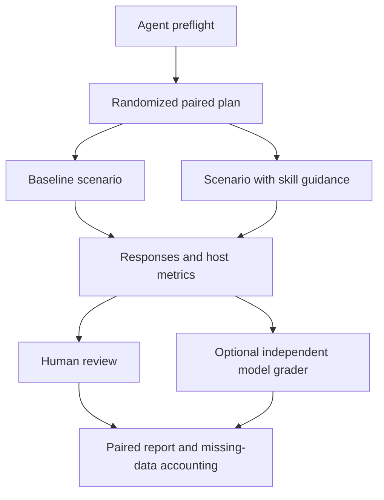

| Benchmark feature | What is available | Evidence status |
|---|---|---|
| Repeatable scenario trials | 66 cases, seeded order, resumable runs and configurable retries | Exercised with synthetic responses |
| Precision and recall | 16 labeled cases, including 5 safe controls | Scoring tested locally |
| Activation | 8 separate probes (4 relevant, 4 unrelated) via trace-capable custom adapters | Live traces pending |
| Paired quality | Independent 0–2 rubric per dimension, safety override, model grades subject to human review | Human overrides and incomplete pairs tested |
| Efficiency | Elapsed time, available token counts and provider-reported USD cost | Parser and local HTTP fixture tested |
| Reporting | Markdown, JSON, SVG and side-by-side matched experiment comparison | Generated and checked locally |

### Release comparison

| Capability | v0.10.0 | v0.11.0 |
|---|---|---|
| Agent execution | User-provided command | Built-in CLI and API adapters plus custom commands |
| Scenario suites | Full catalog or custom cases | Six-case pilot, full catalog or custom cases |
| Grade intake | Human-authored JSON | Template, human grades and optional provisional model grades |
| Failed attempts | Retained, with new trials for repeats | Retained history with explicit resume and retry options |
| Reports | Markdown and JSON | Markdown, JSON, SVG and matched experiment comparison |

### Run a pilot

```sh
python tools/benchmark.py doctor
python tools/benchmark.py evaluate benchmark-runs/smoke --agent mock --cases outbox-crash
```

The smoke run produces two synthetic responses and an ungraded report. For a live Codex pilot, set `BENCHMARK_MODEL` to a model identifier available to your account. Three repeats of the six-case pilot schedule 36 evaluations. Use a new output directory for each new design.

```sh
python tools/benchmark.py evaluate benchmark-runs/codex-pilot --agent codex --model "$BENCHMARK_MODEL" --suite pilot --trials 3 --allow-external-execution
```

CLI adapters cover Codex, Claude Code and GitHub Copilot CLI. Chat Completions adapters cover Ollama, LiteLLM, LM Studio, OpenAI and compatible endpoints. Set `--judge-model` to use an independent grader or complete `grades.template.json` as `grades.json` for human review. The runner writes `report.md`, `report.json` and `report.svg`. See the [benchmark guide](evals/README.md) for provider setup, PowerShell model syntax, retry behavior and the custom adapter protocol.

### Context optimization without sacrificing safety

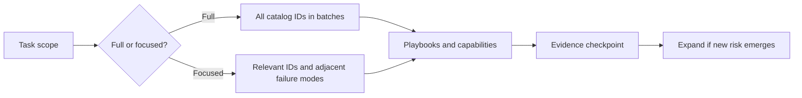

Use the optional offline router:

```sh
python tools/context.py SDP-023 SDP-024 SDP-171
```

For these three example IDs, two relevant playbooks total **14,157 UTF-8 bytes**, compared with **142,906 bytes** for all 24 playbooks. This is a reference-size comparison only; core instructions, adjacent risks, capability/security references, source code, actual reads and tokenization are excluded. It is not a measured model token reduction. Full assessments still cover all 235 problems. See [context strategy](skills/solution-design-hardening/references/CONTEXT-STRATEGY.md).

## Examples

### Example finding: database and broker dual write

**Evidence:** the order is committed before publishing its required event. A process interruption between these steps leaves a committed order without a durable event intent.

**Proposed fix:** persist an immutable event intent in the same transaction as the order. A relay publishes the intent; a duplicate-safe consumer handles redelivery. Monitor relay backlog and reconcile failures.

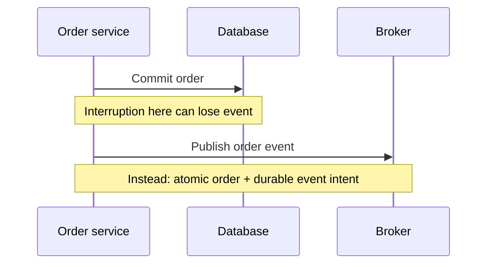

**Verification:** interrupt before the atomic commit; verify both records roll back. Interrupt after commit; verify intent remains recoverable. Interrupt after broker acceptance but before recording delivery; verify repeated delivery has no duplicate business effect.

See [assessment example](examples/assessment-example.md) and [executable fixtures](evals/fixtures/transactions.py). The latter uses SQLite for local atomicity demonstrations, not a real broker.

### Assessment outputs

- `SOLUTION-ARCHITECTURE-MODEL.md`: component, dependency, business operation, invariant and trust-boundary evidence (or an equivalent section in the assessment).
- `SOLUTION-DESIGN-ASSESSMENT.md`: status, evidence, severity and recommended mitigation for every problem.
- `SOLUTION-DESIGN-REMEDIATION-PLAN.md`: prioritized tasks, dependencies, affected code, acceptance criteria, tests and rollout guidance.

Assessment-only requests do not authorize product code changes. Unsupported runtime claims must be marked Requires Verification.

## Validation and evaluation

Requires Python 3.10+; no third-party Python dependencies for the included tools.

```sh
python tools/validate.py
python -m unittest discover -s evals -v
python tools/scan.py /path/to/repository
```

The scanner is a small read-only heuristic helper with 27 candidate rules; its results are **not confirmed defects**. It does not print source lines or secret values. Review candidate locations manually and use the relevant playbook. It is not a full static analyzer.

The executable suite demonstrates vulnerable and corrected outbox, inbox, cache, object access and property binding paths, plus bounded security teaching examples, and checks scanner and scoring behavior. The cache example is a deterministic model, not a Redis integration. GitHub Actions runs the local checks on pushes and pull requests.

For agent comparisons, use the [benchmark runner and evaluation protocol](evals/README.md). The standalone `python tools/score.py results.json` summarizer supports older scoring records. The first live pilot covers local Ollama, with cross-agent validation pending. [Pilot results](BENCHMARK-RESULTS.md).

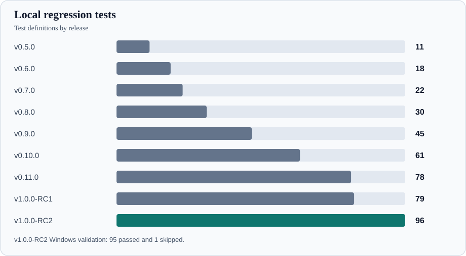

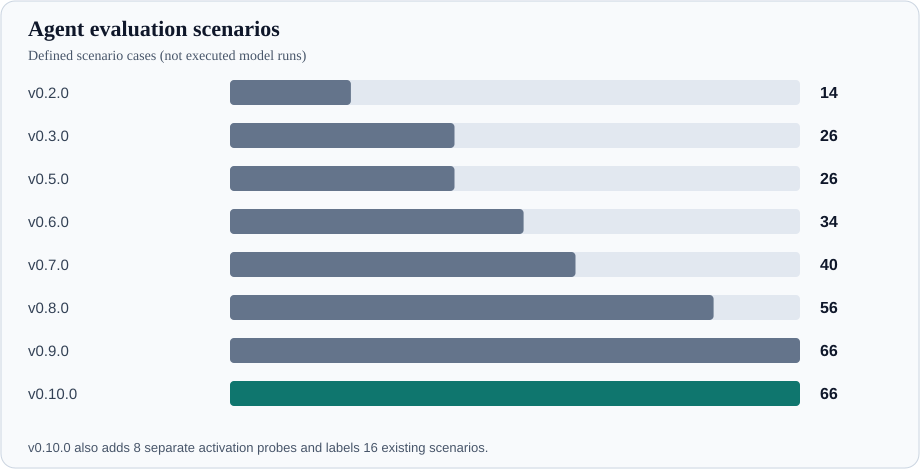

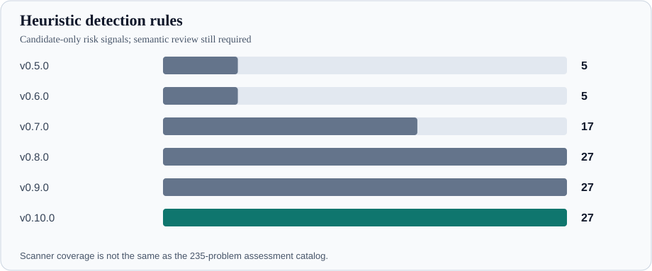

The charts distinguish executable tests from scenario definitions and heuristic rules. None measures model effectiveness.

### Infrastructure integration lab (v0.7.0)

The repository includes an opt-in [disposable Docker Compose lab](integration/README.md) for real PostgreSQL, Redis and RabbitMQ tests, plus an optional SQL Server target. These are examples of verifying capabilities, not a closed list of supported products. The skill's [integration verification guide](skills/solution-design-hardening/references/INTEGRATION-VERIFICATION.md) applies to any stack.

| Layer | Scope | Status at release preparation |
|---|---|---|
| Offline structural checks | 235 IDs, playbooks, links, 66 evaluation cases, scanner mappings | Passed |
| Local regression suite | 79 tests covering adapters, reporting, 27 scanner signals and safe controls | 78 passed, 1 platform-specific skip on Windows |
| Default infrastructure lab | 12 tests for database process exits, reservations, Redis stale refill, RabbitMQ redelivery and relay replay | 12 passed |
| Optional SQL Server lab | 3 tests: atomic commit/rollback and stale rowversion rejection | Not run; requires explicit EULA acceptance |
| Actual agent benchmarks | Local Ollama pilot of six scenarios and three repeats | 36 responses, 18 provisionally graded pairs |

To run the default lab in a dedicated disposable project (requires Docker/Compose):

```sh
docker compose -p sdh-v070-lab -f integration/compose.yaml up --build --abort-on-container-exit --exit-code-from tests tests
```

See the [release validation report](RELEASE-VALIDATION.md). Follow the [lab instructions](integration/README.md) for recording versions, cleanup, optional SQL Server and experiment limitations. CI includes a dedicated integration workflow. Local unit tests remain dependency-free. The scanner is heuristic, line-based and may miss cross-file or multi-line risks; a hit is never a confirmed defect. No technology is unsupported merely because a scanner rule or fixture is absent.

## Roadmap

| Release | Milestone | Status |
|---|---|---|
| v0.1.0 | 100-problem baseline | Complete |
| v0.2.0 | Stable IDs, assessment methodology, evaluation cases | Complete |
| v0.3.0 | 160 problems and targeted playbooks | Complete |
| v0.4.0 | Technology-specific guides | Included in v0.5.0 |
| v0.5.0 | Initial executable fixtures, heuristic scanner, evaluation scoring | Complete |
| v0.6.0 | Adaptive Technology Intelligence | Complete |
| v0.7.0 | Real-service integration lab, expanded detection and fault injection | Implemented; infrastructure run pending |
| v0.8.0 | Comprehensive Security Hardening | Implemented; local checks passed |
| v0.9.0 | Architectural Intelligence: dependency, transaction, invariant and trust-boundary mapping | Implemented; local checks passed |
| v0.10.0 | Benchmark runner, paired scoring, labeled cases, activation probes, context routing | Implemented |
| v0.11.0 | Built-in adapters, preflight, retries, grading and automated reports | Local validation complete |
| v1.0.0-RC1 | Empirical model benchmarks and infrastructure integration runs | Local pilot and default lab complete |
| v1.0.0 | Validated effectiveness, compatibility, community feedback | Planned |

## Release readiness and v1.0.0 gates

| Gate | v1.0.0-RC1 status |
|---|---|
| Stable catalog, playbooks, standards mappings and internal links | Passed offline structural checks |
| Local tool and teaching-fixture regression suite | 78 passed, 1 platform-specific skip on Windows |
| Real-service integration and failure recovery | 12 default tests passed. Optional SQL Server remains pending. |
| Baseline vs skill quality, precision and recall | One Ollama pilot completed. Human adjudication and a second model are pending. |
| Cross-agent activation and context cost | Pending real host traces and actual usage |
| Competing-skill comparisons | Pending licensed, isolated, fair evaluation |
| Community validation and compatibility | Pending |

Before declaring v1.0.0, pre-register acceptance thresholds, run the infrastructure suite and multiple independent benchmark trials, publish sanitized reproducible results (including failures and negative controls), document tested host/model versions, and resolve safety regressions. No fixed score threshold has been adopted without maintainer agreement.

## Repository map

| Location | Purpose |
|---|---|
| [skills/solution-design-hardening](skills/solution-design-hardening/SKILL.md) | Installable skill, 24 playbooks, adaptive capability/security references and templates |
| [tools](tools/ARCHITECTURE.md) | Offline scanner, discovery, architecture, correlation and context tools, plus opt-in benchmark tooling |
| [evals](evals/README.md) | Scenario catalog, gold labels, activation probes, tests and mock adapter |
| [integration](integration/README.md) | Optional disposable infrastructure lab |
| [examples](examples/assessment-example.md) | Illustrative assessment and architectural model |
| [Release validation](RELEASE-VALIDATION.md) | Actual release-preparation checks and unexecuted work |
| [Benchmark results](BENCHMARK-RESULTS.md) | Model settings, paired results, known failure patterns and infrastructure evidence |
| [Changelog](CHANGELOG.md) | Version history and milestones |

## Contributing

Report reproducible failure scenarios, propose targeted safeguards and add negative controls. Preserve stable problem IDs, avoid duplicate entries, and run local validation before opening a pull request. See [CONTRIBUTING.md](CONTRIBUTING.md) and [source review](SOURCE-REVIEW.md).

## Limitations and license

This is an instructional skill, not a certification, automated proof system or guarantee of production reliability. Real infrastructure behavior, correctness targets and provider versions must be independently validated. MIT license; repository owner should confirm copyright and licensing rights before publication. See [LICENSE](LICENSE).
