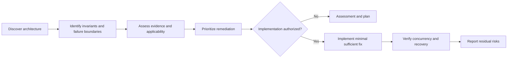
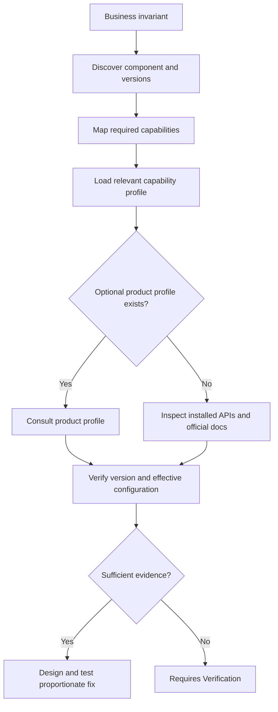

# Solution Design Hardening

**Build software that survives concurrency, failures, and scale.**

   

An open-source, evidence-driven AI coding skill for discovering, preventing, fixing and verifying architectural correctness problems in transactional, distributed and highly available applications. Designed for solution architects, backend engineers, platform engineers and coding agents.

[Quick start](#quick-start) · [Coverage](#coverage) · [Examples](#examples) · [Validation](#validation-and-evaluation) · [Roadmap](#roadmap)

## Why this skill exists

A system may pass ordinary functional tests and still charge customers twice, lose committed events, overwrite newer data, or collapse under retries. Architecture hardening means reasoning about business invariants across real transaction boundaries, concurrent requests, external dependencies, crashes and recovery — not simply checking that a design pattern or library is present.

| Failure scenario | Example mitigation | What must be verified |
|---|---|---|
| Duplicate payment | Durable idempotency and provider reconciliation | Concurrent retries produce one business effect |
| Inconsistent ledger | Atomic balanced postings | Debits and credits balance per currency |
| Database + broker dual write | Transactional outbox | Committed event intent survives interruption |
| Duplicate event processing | Transactional inbox | Replay produces no extra local effect |
| Stale cache refill | Generation-aware cache writes | Older reads cannot defeat invalidation |
| Retry storm | Bounded retries, jitter, deadlines | Downstream load stays within capacity |
| Expired distributed lock | Resource-enforced fencing | Obsolete owners cannot write |
| Mixed-version deployments | Expand-contract migration | Both versions work during rollout |

## Quick start

Install from GitHub with the Skills CLI (requires Node.js/npm):

```sh
npx skills add ameralqarallih-lgtm/solution-design-hardening --skill solution-design-hardening
```

The command assumes this repository and version have been published. To install manually, copy `skills/solution-design-hardening/` into your agent's supported skills directory, such as `.claude/skills/` or `.agents/skills/` where supported. Consult your agent's documentation. The skill uses the [Agent Skills open format](https://agentskills.io/specification); individual agent versions have not yet been compatibility tested.

### Assess an existing codebase

```text
Use solution-design-hardening to assess the entire codebase against the
problem catalog. Provide an evidence-based assessment and prioritized
remediation plan. Do not modify source code.
```

### Implement approved fixes

```text
Use solution-design-hardening to implement the approved remediation tasks.
Follow dependencies, preserve business behavior, and verify failure cases.
```

### Prevent defects while developing or reviewing

```text
Apply solution-design-hardening to this feature or code review.
Identify applicable invariants and failure boundaries; avoid unnecessary patterns.
```

## How it works



The agent loads only the relevant problem playbooks and technology guides for focused work. Full assessments cover the bundled baseline plus distinct project-specific problems, cross-mapping duplicates. The skill does not require all patterns to be implemented.

## Coverage

160 stable problem IDs, 16 domain playbooks, 17 capability profiles, 12 optional product profiles, and 34 scenario-based agent evaluation cases.

| Domain | Problem IDs |
|---|---|
| Financial and transactional correctness | SDP-001–010, SDP-101–104 |
| Caching | SDP-011–022 |
| Databases and consistency | SDP-023–037 |
| Resilience and distributed coordination | SDP-038–053, SDP-125–130 |
| Messaging | SDP-054–068 |
| APIs | SDP-069–080 |
| Workflows | SDP-081–091 |
| Object storage | SDP-092–100 |
| Data migration | SDP-105–111 |
| Integration and operations | SDP-112–124 |
| Security | SDP-131–136 |
| Deployment and resources | SDP-137–145 |
| Observability and tenancy | SDP-146–150 |
| Lifecycle | SDP-151–160 |

Browse the [full problem catalog](skills/solution-design-hardening/references/SOLUTION-DESIGN-PROBLEMS.md), [core skill](skills/solution-design-hardening/SKILL.md), and [technology guides](skills/solution-design-hardening/references/technologies/README.md).

### Adaptive Technology Intelligence

**No fixed supported-technology list.** Discover the stack dynamically, identify the capabilities required by the business invariant, verify version and configuration, then select the simplest supported implementation. Unlisted or proprietary technologies follow the same workflow; unverifiable guarantees remain open verification tasks.



| Layer | Responsibility |
|---|---|
| Universal problems | 160 stable failure scenarios and 16 playbooks |
| Discovery | Component-specific manifest, dependency, configuration and topology evidence |
| Capability mapping | 17 reusable technology-independent domains |
| Product profiles | 12 optional accelerators, not prerequisites |
| Verification | Separate declared, resolved and deployed versions; verify effective guarantees |

The [capability index](skills/solution-design-hardening/references/technology/CAPABILITY-MAPPING.md) includes databases, caching, messaging, streaming, workflows, workers, storage, runtimes, data access, coordination, orchestration, serverless, identity, APIs, search and observability. Existing profiles for .NET, Java, Node.js, Python, SQL Server, PostgreSQL, MongoDB, Redis, RabbitMQ, Kafka, Kubernetes and S3-compatible storage remain available. None is a claim of tested product compatibility.

**Example:** An unfamiliar queue with a `complete()` API is not assumed to behave like RabbitMQ. The agent verifies acknowledgment, durability and replay semantics and tests the failure boundary after the consumer commit. If it cannot establish those guarantees, it records Requires Verification rather than inventing an API or recommending unnecessary migration.

Use the [technology inventory template](skills/solution-design-hardening/assets/technology-inventory.md) for traceable evidence. Optional manifest discovery:

```sh
python tools/discover.py /path/to/repository
```

The helper is offline and read-only. It recognizes selected manifest filenames and limited toolchain version metadata; it does not resolve dependencies, inspect deployed services or prove capabilities. Missing signals do not imply an unsupported stack.

## Examples

### Example finding: database and broker dual write

**Evidence:** the order is committed before publishing its required event. A process interruption between these steps leaves a committed order without a durable event intent.

**Proposed fix:** persist an immutable event intent in the same transaction as the order. A relay publishes the intent; a duplicate-safe consumer handles redelivery. Monitor relay backlog and reconcile failures.

**Verification:** interrupt before the atomic commit; verify both records roll back. Interrupt after commit; verify intent remains recoverable. Interrupt after broker acceptance but before recording delivery; verify repeated delivery has no duplicate business effect.

See [assessment example](examples/assessment-example.md) and [executable fixtures](evals/fixtures/transactions.py). The latter uses SQLite for local atomicity demonstrations, not a real broker.

### Assessment outputs

- `SOLUTION-DESIGN-ASSESSMENT.md`: status, evidence, severity and recommended mitigation for every problem.
- `SOLUTION-DESIGN-REMEDIATION-PLAN.md`: prioritized tasks, dependencies, affected code, acceptance criteria, tests and rollout guidance.

Assessment-only requests do not authorize product code changes. Unsupported runtime claims must be marked Requires Verification.

## Validation and evaluation

Requires Python 3.10+; no third-party Python dependencies for the included tools.

```sh
python tools/validate.py
python -m unittest discover -s evals -v
python tools/scan.py /path/to/repository
```

The scanner is a small read-only heuristic helper with five candidate rules; its results are **not confirmed defects**. It does not print source lines or secret values. Review candidate locations manually and use the relevant playbook. It is not a full static analyzer.

The executable suite demonstrates vulnerable and corrected outbox, inbox and cache paths, and checks scanner and scoring behavior. The cache example is a deterministic model, not a Redis integration. GitHub Actions runs the local checks on pushes and pull requests.

For agent comparisons, use the [evaluation protocol](evals/README.md) and `python tools/score.py results.json` to aggregate human-reviewed paired trials. Do not expose expected answers to the evaluated agent. No actual cross-agent benchmark scores have been generated yet.

## Roadmap

| Release | Milestone | Status |
|---|---|---|
| v0.1.0 | 100-problem baseline | Complete |
| v0.2.0 | Stable IDs, assessment methodology, evaluation cases | Complete |
| v0.3.0 | 160 problems and targeted playbooks | Complete |
| v0.4.0 | Technology-specific guides | Included in v0.5.0 |
| v0.5.0 | Initial executable fixtures, heuristic scanner, evaluation scoring | Complete |
| v0.6.0 | Adaptive Technology Intelligence | Current release candidate |
| v0.7.0 | Real integration fixtures, expanded detection and fault injection | Planned |
| v0.8.0 | Dependency, transaction and invariant mapping | Planned |
| v0.9.0 | Cross-agent benchmarks and context optimization | Planned |
| v1.0.0 | Validated effectiveness, compatibility, community feedback | Planned |

## Contributing

Report reproducible failure scenarios, propose targeted safeguards and add negative controls. Preserve stable problem IDs, avoid duplicate entries, and run local validation before opening a pull request. See [CONTRIBUTING.md](CONTRIBUTING.md) and [source review](SOURCE-REVIEW.md).

## Limitations and license

This is an instructional skill, not a certification, automated proof system or guarantee of production reliability. Real infrastructure behavior, correctness targets and provider versions must be independently validated. MIT license; repository owner should confirm copyright and licensing rights before publication. See [LICENSE](LICENSE).
